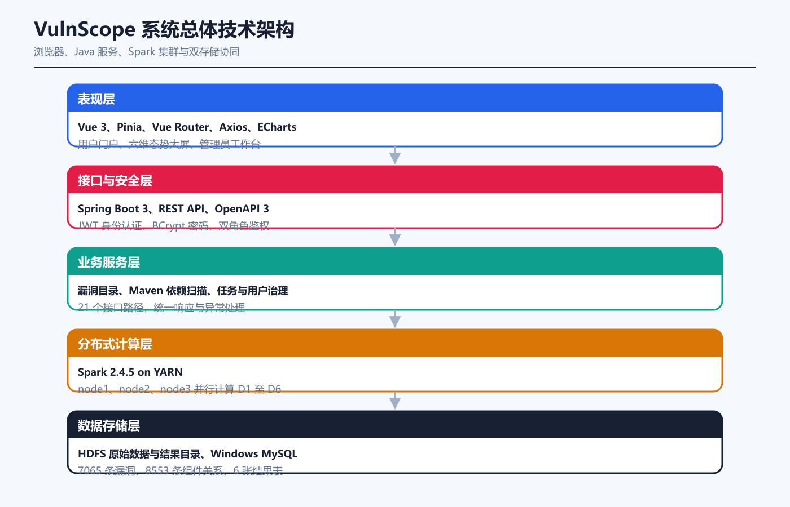

# VulnScope

VulnScope 是一个面向开源依赖风险分析的全栈实践项目。系统将公开漏洞数据写入 HDFS，由 YARN 调度 Java Spark 作业完成六维统计，再把结果回写 MySQL；Spring Boot 提供鉴权与查询接口，Vue 3 + ECharts 完成可视化，FastAPI Agent 只通过受控后端接口获取证据并生成可追溯回答。

> 这是学习与工程实践项目，不应替代专业漏洞管理平台或安全审计结论。

## 核心能力

- 使用 Java Spark 在 YARN 上完成趋势、严重度、CWE、Maven 组件、风险散点和风险流向六维分析。
- 使用 Spring Boot、Spring Security、JWT、MySQL 提供用户、漏洞、扫描、分析和管理接口。
- 使用 Vue 3、Pinia、Vue Router、ECharts 构建普通用户与管理员界面。
- 上传 Maven `pom.xml` 后分析直接依赖，并保存用户侧扫描结果。
- 使用 FastAPI 构建证据约束型问答 Agent；未配置模型时自动使用离线规则，配置兼容接口后仅对后端证据进行解释。
- OpenAPI 文件可直接用于接口联调，关键配置与凭据均通过环境变量注入。

## 技术架构

```text
OSV Maven / CISA KEV public data
                |
                v
          HDFS + Spark on YARN
                |
                v
             MySQL
                |
                v
Vue 3 <---- Spring Boot REST API ----> FastAPI evidence agent
```



## 目录结构

```text
VulnScope/
|- backend/          Spring Boot 后端
|- frontend/         Vue 3 前端
|- spark-job/        Java Spark 分析作业
|- agent-service/    Python FastAPI Agent
|- database/         MySQL 表结构与迁移
|- data/             数据准备脚本与说明
`- docs/             OpenAPI、样例、截图与验收记录
```

## 快速开始

### 1. 准备数据库

复制 `database/.env.example` 为项目根目录 `.env`，填写本机数据库账号、JWT 密钥和管理员密码。然后执行：

```bash
mysql -u root -p < database/schema.sql
```

### 2. 启动后端

```bash
cd backend
mvn spring-boot:run
```

默认接口地址为 `http://127.0.0.1:19081`，Swagger UI 为 `http://127.0.0.1:19081/swagger-ui.html`。

### 3. 启动前端

```bash
cd frontend
npm ci
npm run dev
```

### 4. 启动可选 Agent

```bash
cd agent-service
python -m pip install -r requirements.txt
python -m uvicorn app.main:app --host 127.0.0.1 --port 19082
```

如果未配置模型密钥，Agent 会明确返回 `offline_rules`；如果配置了兼容服务，回答仍需携带所使用的后端证据。

### 5. 运行 Spark 作业

构建 `spark-job` 后，按 [Spark 作业说明](spark-job/README.md) 配置集群地址与 JDBC 参数。数据库密码必须通过 `VULNSCOPE_DB_PASSWORD` 环境变量提供。

## 验收结果

在课程实验环境中，Spark 作业成功处理 12,873 条公开漏洞记录并向六张 MySQL 结果表写入 525 行结果；权限隔离、前后端联调、真实任务提交、离线 Agent 与模型增强模式均完成验收。详细记录见 [docs/VALIDATION.md](docs/VALIDATION.md)。

## 配置与安全

- 不提交 `.env`、模型密钥、数据库密码、构建目录或原始大数据文件。
- Spark 远程执行默认关闭，需显式设置 `VULNSCOPE_SPARK_SUBMIT_ENABLED=true`。
- Agent 不直接访问 MySQL、HDFS 或 YARN，只调用受控的后端统计接口。
- 公开仓库不包含课程提交材料、学号、班级、教师信息和本地实验网段。

## 开发说明

本项目使用 AI 辅助完成部分代码生成、文档整理与问题排查；作者负责需求拆解、技术路线、实验环境部署、功能测试、跨模块联调和验收。评估项目时请以仓库源码、配置边界和可复现结果为准。

## License

项目源码使用 [MIT License](LICENSE)。公开漏洞数据由各自来源提供，其许可与使用条款不随本仓库改变。
